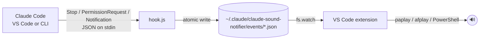

# Sound Notifier for Claude Code

[](https://marketplace.visualstudio.com/items?itemName=masdeveloper.vscode-claude-sound-notifier)
[](https://marketplace.visualstudio.com/items?itemName=masdeveloper.vscode-claude-sound-notifier)

A VS Code extension that plays a sound when **Claude Code needs your approval** or **finishes a response**, so you can switch to something else while it works.

- 🔔 **Approval needed**: two rising notes when Claude is waiting on a permission prompt
- ✅ **Done**: a short arpeggio when Claude finishes its turn
- 💤 **Idle** (optional): a soft tap when Claude has been waiting for your input for a while
- 🪟 **Window-aware**: each VS Code window only reacts to Claude sessions inside its own workspace
- 🔇 **One-click mute** from the status bar
- 🎵 Built-in sounds are synthesized in code (no third-party audio), or use your own `.wav`

Works with both the Claude Code VS Code extension and the `claude` CLI, on Linux, macOS and Windows.

## How it works

Claude Code doesn't expose an API to other extensions, but it does run **[hooks](https://docs.claude.com/en/docs/claude-code/hooks)** (shell commands) on lifecycle events. The extension uses them as a bridge:



1. **Hook registration**: on first run the extension offers to add three hooks to `~/.claude/settings.json` (`Stop`, `PermissionRequest`, `Notification`). Existing hooks are preserved and a backup is written to `settings.json.bak-sound-notifier`.
2. **Event capture**: `hook.js` reads the hook payload from stdin and writes it to the events folder (write-to-temp, then rename, so readers never see partial files). It never prints or fails loudly, so it can't interfere with Claude.
3. **Routing**: every open VS Code window watches the folder. A window only handles events whose `cwd` is inside one of its workspace folders, and **claims** an event with an atomic `rename`, so the sound plays exactly once even with several windows open.
4. **Playback**: the extension host has no audio API, so sounds are played through the OS's own player: `paplay` → `pw-play` → `aplay` on Linux, `afplay` on macOS, `System.Media.SoundPlayer` on Windows.

A single approval can fire both `PermissionRequest` and `Notification`, so events are debounced per category.

## Requirements

- Claude Code (VS Code extension or CLI)
- `node` on your `PATH` (it runs the hook script)
- Linux only: `paplay`, `pw-play` or `aplay` (preinstalled on most desktops)

## Usage

1. Install the extension from the [VS Code Marketplace](https://marketplace.visualstudio.com/items?itemName=masdeveloper.vscode-claude-sound-notifier) (or run `code --install-extension masdeveloper.vscode-claude-sound-notifier`) and click **Install** on the prompt, or run **Claude Sound: Install Claude Code Hooks** from the Command Palette.
2. Restart any running Claude Code sessions so they load the new hooks.
3. Run **Claude Sound: Test Sounds** to check your audio.

| Command | What it does |
| --- | --- |
| `Claude Sound: Install Claude Code Hooks` | Adds the hooks to `~/.claude/settings.json` |
| `Claude Sound: Uninstall Claude Code Hooks` | Removes only this extension's hooks |
| `Claude Sound: Toggle Mute` | Mutes/unmutes (also: click the 🔔 in the status bar) |
| `Claude Sound: Test Sounds` | Plays every sound once |

## Settings

| Setting | Default | Description |
| --- | --- | --- |
| `claudeSoundNotifier.enabled` | `true` | Master switch |
| `claudeSoundNotifier.volume` | `70` | 0–100 (not supported on Windows or `aplay`) |
| `claudeSoundNotifier.repeat` | `1` | How many times each sound plays per event (1–10) |
| `claudeSoundNotifier.scope` | `workspace` | `workspace`: only sessions in this window's folders. `all`: every session on the machine |
| `claudeSoundNotifier.onlyWhenWindowUnfocused` | `false` | Stay quiet while you're looking at VS Code |
| `claudeSoundNotifier.permission.enabled` / `.sound` | `true` / `default` | Approval-needed sound |
| `claudeSoundNotifier.done.enabled` / `.sound` | `true` / `default` | Response-finished sound |
| `claudeSoundNotifier.idle.enabled` / `.sound` | `false` / `default` | Waiting-for-input sound |

`*.sound` accepts `default`, `none`, or a path to a `.wav` file (`~` is expanded).

## Development

```bash
npm install
npm run compile      # or: npm run watch
npm run sounds       # regenerate media/*.wav
```

Press **F5** in VS Code to launch an Extension Development Host. To build a `.vsix`:

```bash
npm run package
code --install-extension vscode-claude-sound-notifier-0.2.0.vsix
```

### Project layout

```
src/
  extension.ts      activation, commands, status bar, event → sound routing
  eventWatcher.ts   watches the events folder; claims events atomically across windows
  hookInstaller.ts  safely merges/removes hooks in ~/.claude/settings.json
  soundPlayer.ts    cross-platform playback via the OS's audio CLI
  paths.ts          shared file locations
resources/hook.js   the script Claude Code runs on each hook
scripts/generate-sounds.js  synthesizes the built-in WAV files
```

## Uninstalling

Removing the extension cleans up after itself: the next time VS Code starts, it removes this extension's hooks from `~/.claude/settings.json` and deletes `~/.claude/claude-sound-notifier`. To stop the sounds without uninstalling, run **Claude Sound: Uninstall Claude Code Hooks**.

## License

MIT. Not affiliated with or endorsed by Anthropic.
